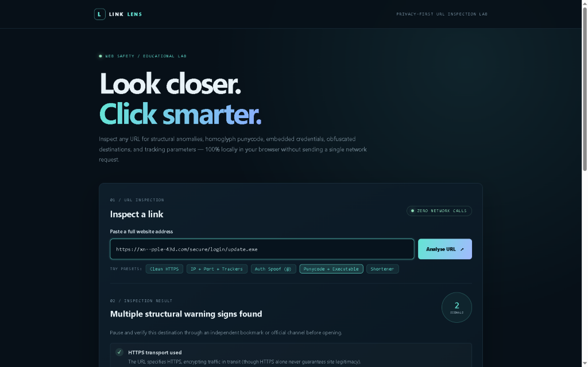

# LinkLens — Privacy-First URL Safety & Anatomy Lab

**LinkLens** is a zero-dependency client-side URL inspection and phishing-awareness learning tool. All URL parsing, heuristic checks, and tracking-parameter stripping run locally in the browser with **zero external API calls**.

---

## Application Preview




## Features

- **Local Heuristic Checks**
  - Detects unencrypted `http://` transport and non-standard ports
  - Flags deceptive `user@host` authority spoofing syntax
  - Identifies Punycode (`xn--`) internationalized labels (homoglyph awareness)
  - Detects direct IPv4/IPv6 hosts, URL shorteners, and deeply nested subdomains
  - Flags executable extensions (`.exe`, `.scr`, `.apk`, `.ps1`, etc.) in URL paths
- **Parsed URL Anatomy & Tracker Stripping**
  - Breaks down protocol, hostname, port, path, fragment, and query parameters
  - Highlights common marketing trackers (`utm_*`, `fbclid`, `gclid`, `msclkid`) and lets you copy a clean URL
- **Educational Presets, Session History & JSON Export**
  - Includes built-in test URLs, session-only history, and exportable JSON inspection reports

---

## Tech Stack

- Semantic HTML5, CSS3, ES Module Vanilla JavaScript (`URL` / `URLSearchParams` Web APIs)
- Node.js built-in test runner (`node:test`) for unit verification

---

## Run Locally & Test

```bash
# Run unit tests (Node 18+)
node --test tests/linklens.test.mjs

# Serve locally
npx serve .
```

---

## Honest Limitations

- LinkLens evaluates **URL structure only** — it does not fetch target websites, resolve DNS, inspect TLS certificates, or query threat-intelligence feeds.
- Passing structural checks does not guarantee a link is safe, and triggering a heuristic does not prove malicious intent.

---

## Author

**Muzammil Shabbir** — [GitHub](https://github.com/Muzammil-s) · [LinkedIn](https://www.linkedin.com/in/muzammil-shabbir-7368a7382)
